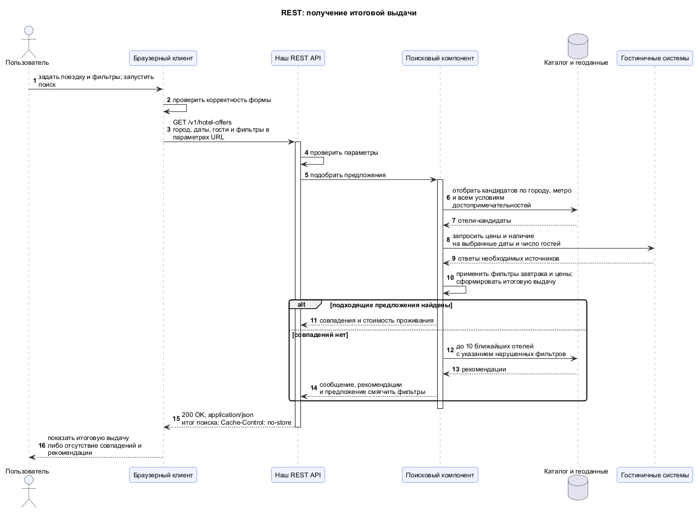
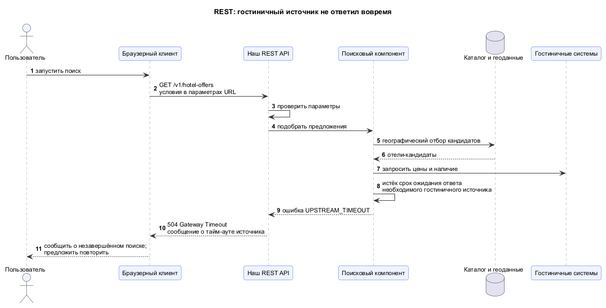
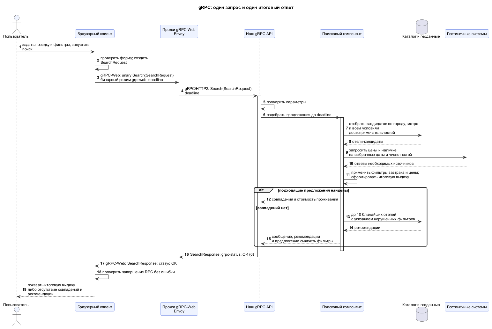
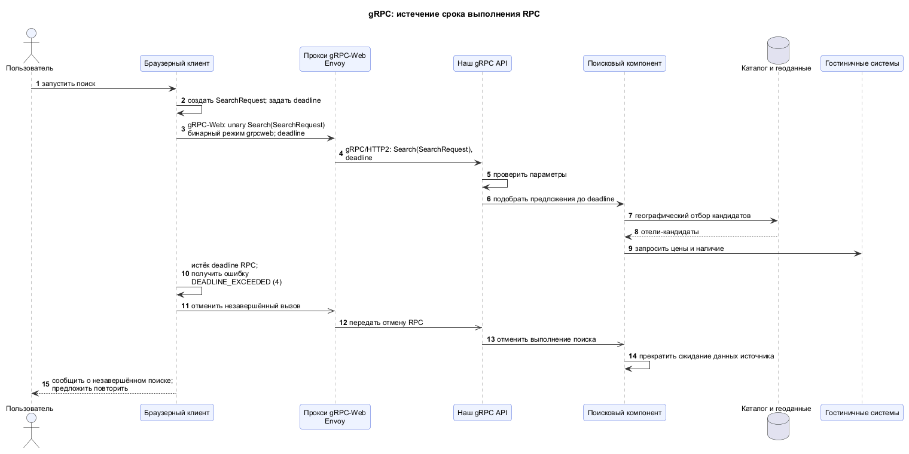
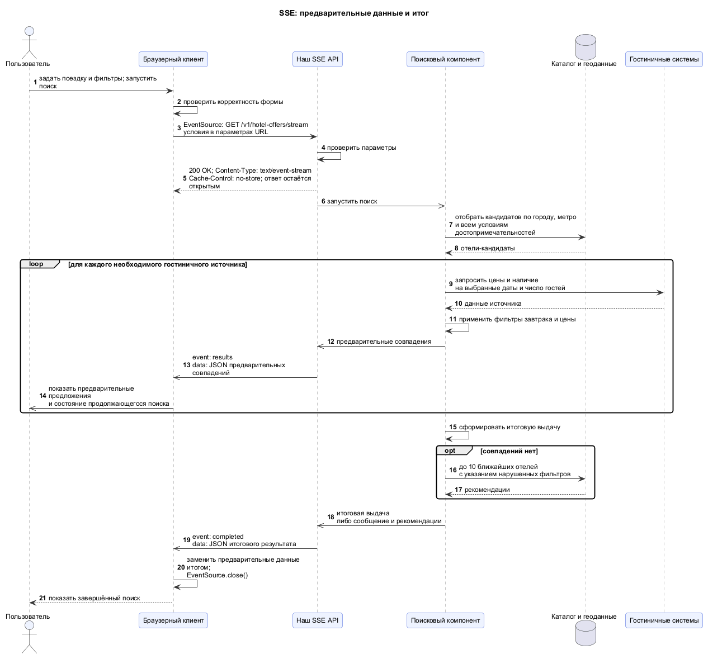
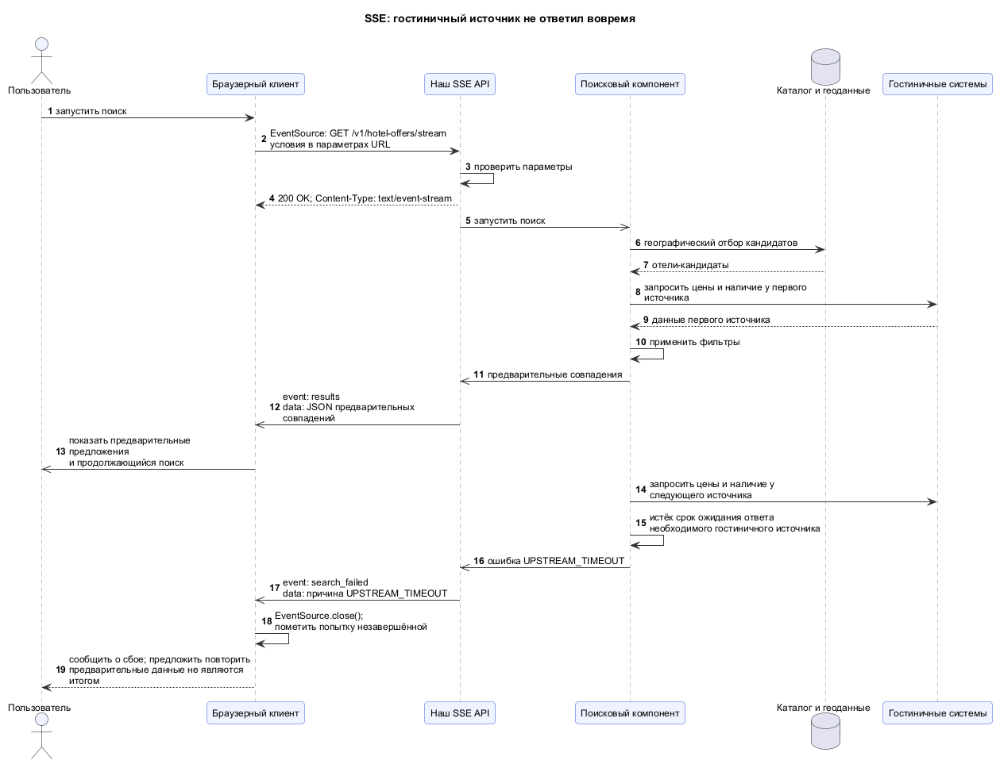

# ДЗ 3 Проектирование поиска отелей

## 1 Бизнес-сценарий

Пользователь ищет отель по городу, датам и числу гостей, задаёт ограничения по метро, достопримечательностям, завтраку и цене. Система получает цены и наличие из гостиничных систем, применяет фильтры и возвращает подходящие предложения. Поиск заканчивается выдачей, сообщением об отсутствии совпадений либо ошибкой.

Поиск – основная точка входа в бронирование. От скорости, точности и понятности выдачи зависит, найдёт ли пользователь подходящий отель и перейдёт ли к покупке. Ошибки цен, длительное ожидание и неудобное сравнение предложений ухудшают клиентский опыт и могут снижать конверсию в бронирование, а значит, выручку сервиса.

Участники: пользователь, клиентское приложение, наш поисковый API и внешние гостиничные системы. Сравниваются синхронный REST, gRPC и Server-Sent Events (SSE). Во всех вариантах сервер сначала отбирает отели по каталогу и географии, затем получает цены и наличие, применяет остальные фильтры и формирует выдачу. Протоколы гостиничных API одинаковы для всех вариантов. Для браузерного gRPC-клиента используется gRPC-Web с прокси Envoy.

Критерии сравнения: скорость доставки, надёжность, масштабируемость, связанность компонентов и сложность реализации. Дополнительный критерий – полнота выдачи.

## 2 Варианты реализации

### Синхронный REST

Клиент запрашивает коллекцию предложений через `GET /v1/hotel-offers`. Город, даты, гости и фильтры передаются в параметрах URL. Сервер проверяет условия и возвращает итоговую выдачу в JSON. Каждый запрос содержит все условия, необходимые для его выполнения.

**Успешный сценарий.** Сервер получает ответы необходимых гостиничных источников и возвращает выдачу с кодом `200 OK`. Если совпадений нет, ответ содержит сообщение, предложение смягчить фильтры и до десяти ближайших отелей с указанием нарушенных условий.

[Открыть изображение](https://github.com/Remsely/cu-system-analysis/blob/main/hw3/export/01_rest_happy.png)

**Ошибка.** Необходимый гостиничный источник не ответил за допустимое время. Наш API агрегирует данные внешних систем и в этой операции выполняет роль шлюза, поэтому возвращает `504 Gateway Timeout`. Клиент сообщает о сбое и предлагает повторить поиск.

504 обозначает именно тайм-аут ответа источника. Некорректный ответ источника соответствует `502 Bad Gateway`, временная недоступность нашего API из-за перегрузки – `503 Service Unavailable`, ошибка нашей серверной логики – `500 Internal Server Error`.

[Открыть изображение](https://github.com/Remsely/cu-system-analysis/blob/main/hw3/export/02_rest_error.png)

**Преимущества**

1. Готовая выдача и HTTP-статус выполнения приходят в одном ответе, что упрощает обработку результата;
2. Запрос не требует сохранения поисковой сессии и может обрабатываться любым доступным экземпляром API;
3. Браузер использует обычный HTTP-клиент без генерации кода или отдельного протокольного прокси.

**Недостатки**

1. До завершения обработки источников ответ не содержит ни предложений, ни сведений о ходе поиска;
2. Запрос остаётся открытым до ответа, поэтому время поиска должно укладываться в тайм-ауты клиента, прокси и сервера;
3. Медленный необходимый источник задерживает всю выдачу, а потеря готового ответа может потребовать повторного поиска.

### gRPC

Используется unary RPC `Search(SearchRequest) returns (SearchResponse)`: один запрос и один итоговый ответ. Контракт сообщений описывается в `.proto`, клиентский код генерируется. Streaming не требуется для текущего результата поиска, хотя gRPC поддерживает и потоковые RPC.

Браузер вызывает метод через gRPC-Web в бинарном режиме `grpcweb`. Envoy преобразует вызов в нативный gRPC по HTTP/2 и возвращает ответ браузеру. Так сохраняется тот же сценарий получения готовой выдачи, что и в REST-варианте.

**Успешный сценарий.** Сервер выполняет поиск и возвращает `SearchResponse` с предложениями либо сообщением и рекомендациями. Вызов успешно завершён, когда клиент получил ответ и итоговый gRPC-статус `OK`.

[Открыть изображение](https://github.com/Remsely/cu-system-analysis/blob/main/hw3/export/03_grpc_happy.png)

**Ошибка.** Пока сервер ждёт гостиничный источник, истекает общий срок выполнения RPC – deadline. Клиент получает `DEADLINE_EXCEEDED` и сообщает о незавершённом поиске, а сервер получает отмену вызова и прекращает ожидание. Если сам gRPC-сервис временно недоступен, используется `UNAVAILABLE`. Клиент проверяет gRPC-статус, а не только HTTP-код ответа.

[Открыть изображение](https://github.com/Remsely/cu-system-analysis/blob/main/hw3/export/04_grpc_error.png)

**Преимущества**

1. Типизированный `.proto`-контракт и генерация клиента уменьшают объём ручного кода сериализации и проверки структуры сообщений;
2. Бинарная сериализация Protobuf и HTTP/2 создают потенциал высокой пропускной способности при интенсивном RPC-обмене; фактический выигрыш для браузера с gRPC-Web и прокси требует измерений;
3. Unary RPC соответствует получению одной готовой выдачи, а серверный streaming можно использовать при появлении требования к постепенному показу результатов.

**Недостатки**

1. Интеграция с фронтендом сложнее обычного HTTP-запроса: нужны gRPC-Web, сгенерированный клиент и прокси либо сервер с поддержкой gRPC-Web;
2. Дополнительный прокси требует настройки и создаёт ещё одну точку возможного отказа, а браузерная адаптация может уменьшить выигрыш нативного gRPC;
3. Изменения `.proto` требуют соблюдения правил совместимости и обновления генерируемого кода;
4. Unary RPC ждёт итогового ответа, поэтому медленный источник задерживает выдачу; истечение deadline или потеря ответа может потребовать нового поиска.

### Server-Sent Events

Клиент через `EventSource` открывает `GET /v1/hotel-offers/stream` с условиями в параметрах. Сервер начинает HTTP-ответ с `Content-Type: text/event-stream`. События `results` содержат предварительные предложения, `completed` – полный итог. После завершения клиент закрывает `EventSource`.

**Успешный сценарий.** Клиент показывает предварительные предложения с состоянием продолжающегося поиска, затем заменяет их итоговой выдачей. Если совпадений нет, `completed` содержит сообщение и рекомендации.

[Открыть изображение](https://github.com/Remsely/cu-system-analysis/blob/main/hw3/export/05_sse_happy.png)

**Ошибка.** После открытия потока гостиничный источник не ответил вовремя. Сервер передаёт `search_failed`, клиент закрывает поток и сообщает о незавершённом поиске. Изменить уже отправленный HTTP-статус нельзя, поэтому ошибку выполнения передаёт событие.

[Открыть изображение](https://github.com/Remsely/cu-system-analysis/blob/main/hw3/export/06_sse_error.png)

**Преимущества**

1. Односторонний поток соответствует поиску, в котором после передачи условий клиент получает результаты от сервера;
2. Предварительные предложения могут появляться до завершения обработки всех источников;
3. Браузерный EventSource предоставляет готовый механизм чтения событий без генерации клиента и gRPC-Web-прокси.

**Недостатки**

1. Клиент обрабатывает предварительные данные, завершение и ошибку как разные состояния поиска;
2. Длительный поток занимает ресурсы, буферизация прокси может задержать события, а тайм-аут при отсутствии данных – оборвать соединение;
3. Переподключение EventSource само по себе не восстанавливает пропущенные данные; в выбранном варианте клиент закрывает поток при ошибке и предлагает новую попытку;
4. Для новых условий нужен новый запрос, а ранний показ отдельных предложений не гарантирует более раннюю готовность полной выдачи.

### Общие ограничения и правила выдачи

1. **Гостиничные источники.** Все варианты выполняют одинаковый отбор и обращаются к тем же источникам. Их задержки и квоты ограничивают поиск независимо от протокола;
2. **Ошибки и пустая выдача.** Сбой необходимого источника означает незавершённый поиск, а не отсутствие подходящих отелей. Во всех вариантах клиент получает сообщение об ошибке;
3. **Полнота результата.** REST и unary gRPC возвращают один итог. В SSE данные предварительные до `completed`; пустая порция ещё не означает отсутствие совпадений. Полный итог повторяет часть предварительных данных и заменяет их на клиенте;
4. **Будущая сортировка.** Сортировка в текущих требованиях не задана. Если появится порядок по цене, после предложения за 7 000 ₽ может прийти предложение за 4 500 ₽. Потребуется перестановка элементов либо показ упорядоченной выдачи после завершения поиска; гарантировать получение самых дешёвых вариантов заранее без дополнительных сведений от источников нельзя;
5. **Повторные попытки.** Повтор после сбоя может заново обратиться к гостиницам. Закрытие клиентского соединения не гарантирует прекращения уже отправленных запросов, поэтому серверу нужны контроль ожидания и ограничение параллелизма.

## 3 Сравнение

| Критерий | REST | gRPC | SSE |
|---|---|---|---|
| Скорость доставки | Один итог после ответов необходимых источников | Один итог после ответов необходимых источников; выигрыш сериализации зависит от нагрузки | Возможен ранний показ отдельных предложений; полный итог зависит от необходимых источников |
| Надёжность | Итог определяется HTTP-статусом и телом ответа | Итог определяется gRPC-статусом; есть deadline, но также дополнительный прокси | Нужны события завершения и ошибки; переподключение не восстанавливает пропущенные данные |
| Масштабируемость | Запрос занимает ресурсы до ответа; поисковая сессия не сохраняется | HTTP/2 допускает несколько RPC на соединении; отдельно учитывается нагрузка на gRPC-Web-прокси | Нужны ресурсы длительных HTTP-потоков и настройка их передачи через прокси |
| Связанность компонентов | Параметры запроса, JSON-ответ и HTTP-ошибки | Общий `.proto`-контракт, сгенерированный клиент и правила совместимости | Параметры запроса, типы событий и правила завершения потока |
| Сложность реализации | Обычный HTTP-клиент, один запрос и ответ | Генерация кода, gRPC-Web и прокси для браузера | EventSource упрощает чтение, но нужны промежуточные состояния, события ошибок и закрытие потока |
| Полнота выдачи | До показа получен итог поиска | До показа получен итог поиска | Данные предварительные до completed, затем заменяются полным итогом |

## 4 Финальный выбор

Выбирается REST: текущему браузерному сценарию достаточно одного готового ответа.

gRPC не выбран из-за затрат на браузерную интеграцию; решение стоит пересмотреть при появлении нативных клиентов или подтверждённой потребности в высокой пропускной способности. SSE не выбран, поскольку постепенная выдача не требуется; решение стоит пересмотреть, если её польза для пользователей будет подтверждена измерениями.

Подходы можно сочетать: REST или SSE для браузера и gRPC между нашими серверными компонентами, если поисковая логика будет выделена в отдельный сервис.
